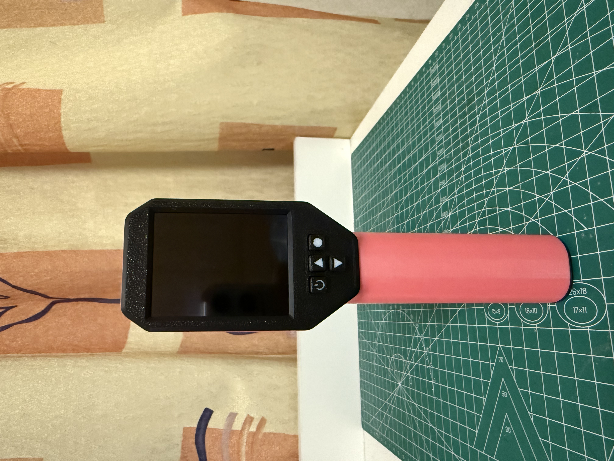
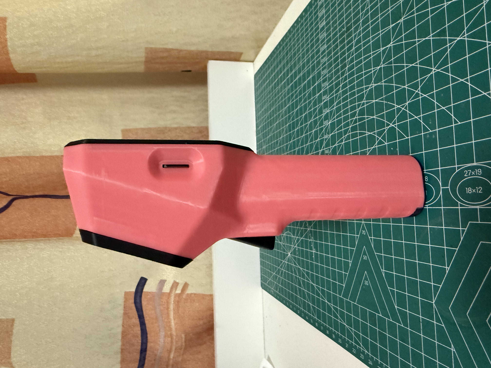
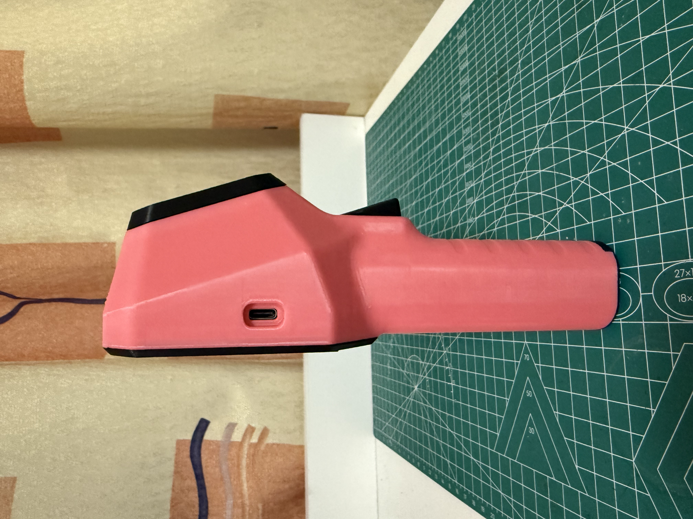
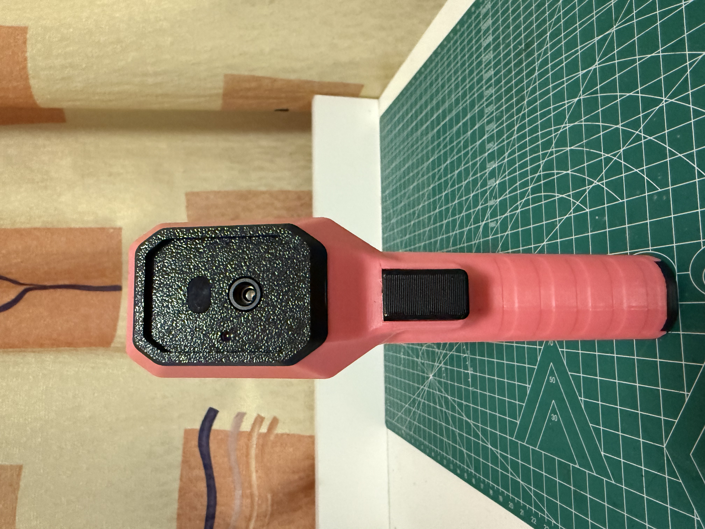
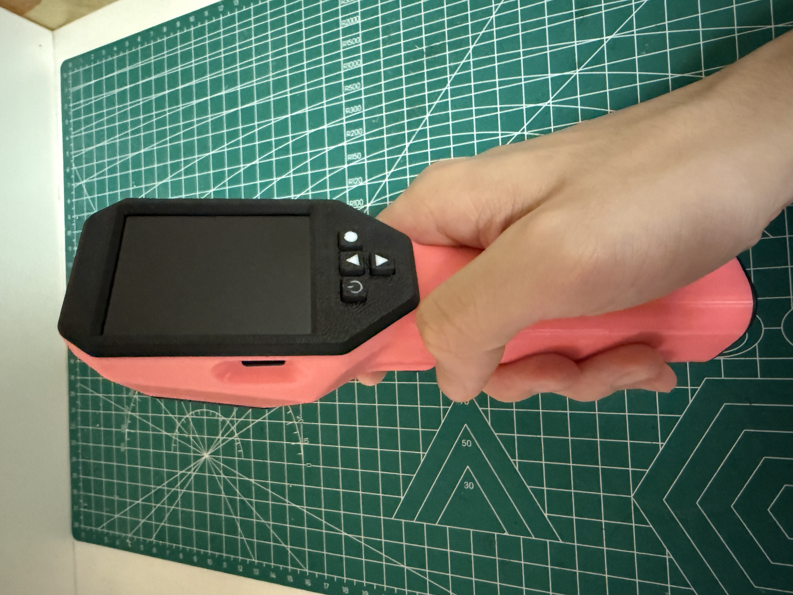

[English](README.md) | [简体中文](README.zh-CN.md)

# 手持热成像仪

这是一个基于 ESP32S3 的手持热成像仪，可将被测物体的热量分布转化为图像并实时显示。

装配说明请看 [docs/assembly.md](docs/assembly.md)

## 状态
v0.1 原型，已验证基本功能。

## 特性
- 可切换色彩方案
- 实体按键操作面板
- 刷新率可调整
- 可显示热点冷点
- 激光测距功能（可选 TOF400C，实验性功能，最大约 400 cm，存在已知问题）
- 截图功能（需要Micro SD Card）
- 激光管辅助定位
- 温度单位可调整
- 18650 电池供电，5V USB 充电
- 可 3D 打印外壳

## 目录
- `hardware/`：原理图、BOM、Gerber
- `firmware/`：固件源码
- `enclosure/`：外壳模型
- `docs/`：装配说明、图片

## 快速开始
> 注意：PCB 厚度必须选 1.2mm；是否安装 TOF400C 决定打样 PCB1 还是 PCB2；屏幕有 IPS/TFT 两种，固件不同。
1. 根据是否安装 TOF400C 选择 PCB1/PCB2，PCB 厚度必须 1.2mm
2. 焊接并完成裸板电源测试
3. 3D 打印所有零件
4. 按装配文档组装
5. 烧录固件并最终测试

## 相关链接
- OSHWHub PCB 打样：(https://oshwhub.com/big_smoke/project_bniojffv)
- MakerWorld 外壳：(https://makerworld.com/zh/models/3447109-handheld-thermal-imager-casing#profileId-3931800) / (https://makerworld.com.cn/zh/models/3109405-shou-chi-re-cheng-xiang-yi-wai-ke#profileId-3661945)
- 装配说明：[docs/assembly.md](docs/assembly.md)
- 固件：[firmware/bin](firmware/bin)

## 已知问题
- TOF400C 测距功能为实验性，最大约 400 cm，执行测距成功率不稳定。

## 许可证
- 硬件设计（PCB、原理图）：CC BY-NC-SA 4.0，见 [LICENSE.md](LICENSE.md)
- 固件源码：PolyForm Noncommercial 1.0.0，见 [firmware/LICENSE.md](firmware/LICENSE.md)
- 文档与图片：CC BY-NC-SA 4.0，见 [LICENSE.md](LICENSE.md)